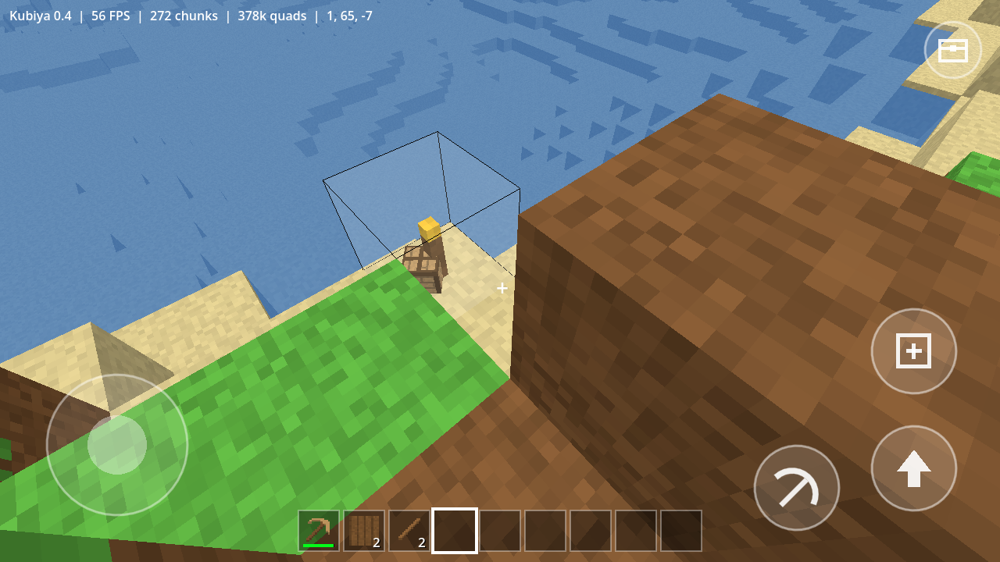
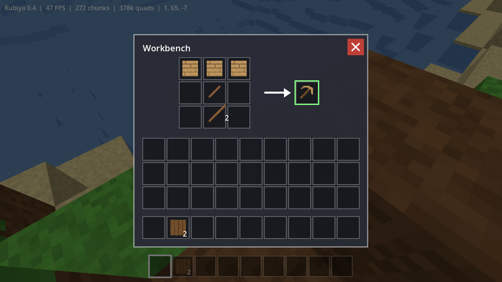

# Kubiya · קובייה

**English** | [עברית](#עברית)

Kubiya is an original, open-source 3D block sandbox game built with Godot 4 and GDScript.
One codebase targets macOS, Windows, Android, iOS and the web browser.

Kubiya is not affiliated with Mojang or Microsoft and is not a copy of any existing game.
The name, textures, sounds and music are original. Textures are generated in code.

## Status

Early development. Stages 1 to 4 are done: an endless generated world with hills,
sea, caves, trees and ores; mining and building; item drops, inventory, crafting and
tools; keyboard, mouse and touch controls; sound and music generated in code.

| Stage | Content | State |
|-------|---------|-------|
| 1 | Repository, project skeleton, terrain, walking | Done |
| 2 | Endless world: 16x16x128 chunks, hills, water, caves, trees, ores, streaming | Done |
| 3 | First-person player, mining, building, hotbar, touch controls, sounds, music | Done |
| 4 | Item drops, inventory, 2x2 and 3x3 crafting, tools, torch, workbench | Done |
| 5 | Save and load, day and night, lighting, smelting, monsters, health, menus | Planned |
| 6 | Builds: macOS `.dmg`, Windows, Android APK, iOS, web | Planned |
| 7 | Download site on GitHub Pages with the browser version | Planned |

## Controls

| Action | Key |
|--------|-----|
| Move | W A S D or arrow keys |
| Look | Mouse (click the window first) |
| Jump / swim up | Space |
| Run | Shift |
| Mine | Hold left mouse button |
| Place block, use workbench | Right mouse button |
| Choose hotbar slot | 1 to 9, or mouse wheel |
| Inventory and 2x2 crafting | E |
| Music on / off | M |
| Release mouse | Esc |

Touch: joystick on the left, buttons for jump, mine (hold) and place on the right,
drag anywhere else to look, tap a hotbar slot to choose it, bag button for the inventory.

## Crafting

Mined blocks fall as items; walk over them to pick them up. Open the inventory for
the 2x2 grid. Place a workbench and use it for the 3x3 grid. Tap a stack to pick it
up, tap a crafting cell to put down one item, tap the result to craft.

| Result | Recipe |
|--------|--------|
| 4 planks | 1 log |
| 4 sticks | 2 planks, one above the other |
| Workbench | 4 planks in a square |
| 4 torches | coal above a stick |
| Furnace | 8 stone in a ring |
| Pickaxe | 3 planks or stone in a row, 2 sticks below the middle |
| Axe | 3 planks or stone in an L, 2 sticks below |
| Shovel | 1 plank or stone, 2 sticks below |
| Sword | 2 planks or stone, 1 stick below |

Stone and coal need a pickaxe. Iron, gold and crystal need a stone pickaxe.
The right tool mines faster. Tools wear out.

## Run from source

Ready-made downloads arrive in stage 6. Until then:

1. Install [Godot 4.7](https://godotengine.org/download) or newer.
2. Clone this repository.
3. Open `project.godot` in Godot and press F5.

## License

MIT. See [LICENSE](LICENSE).

---

## עברית

קובייה (Kubiya) הוא משחק בלוקים תלת־ממדי מקורי בקוד פתוח, בנוי ב־Godot 4 וב־GDScript.
קוד אחד מיועד למק, ווינדוס, אנדרואיד, אייפון ודפדפן.

המשחק אינו קשור ל־Mojang או ל־Microsoft ואינו העתק של משחק קיים.
השם, הטקסטורות, הצלילים והמוזיקה מקוריים. הטקסטורות נוצרות בקוד.

### מצב

פיתוח מוקדם. שלבים 1 עד 4 הושלמו: עולם אינסופי עם גבעות, ים, מערות, עצים ועפרות; כרייה ובנייה; פריטים נופלים, מלאי, יצירת חפצים וכלים; שליטה במקלדת, עכבר ומגע; צלילים ומוזיקה שנוצרים בקוד.

| שלב | תוכן | מצב |
|-----|------|-----|
| 1 | ריפו, שלד הפרויקט, עולם, הליכה | בוצע |
| 2 | עולם אינסופי: צ'אנקים 16x16x128, גבעות, מים, מערות, עצים, עפרות, טעינה דינמית | בוצע |
| 3 | שחקן בגוף ראשון, כרייה, בנייה, סרגל חפצים, שליטה במגע, צלילים, מוזיקה | בוצע |
| 4 | פריטים נופלים, מלאי, יצירה 2x2 ו־3x3, כלים, לפיד, שולחן עבודה | בוצע |
| 5 | שמירה וטעינה, יום ולילה, תאורה, התכה, מפלצות, חיים, תפריטים | מתוכנן |
| 6 | גרסאות: מק (`.dmg`), ווינדוס, אנדרואיד (APK), אייפון, דפדפן | מתוכנן |
| 7 | אתר הורדה ב־GitHub Pages עם גרסת הדפדפן | מתוכנן |

### מקשים

| פעולה | מקש |
|-------|-----|
| תנועה | W A S D או מקשי החצים |
| מבט | עכבר (קודם לוחצים על החלון) |
| קפיצה / שחייה למעלה | רווח |
| ריצה | Shift |
| כרייה | לחיצה ארוכה על כפתור שמאלי |
| הצבת בלוק, שימוש בשולחן עבודה | כפתור ימני |
| בחירת משבצת בסרגל | 1 עד 9, או גלגלת |
| מלאי ויצירה 2x2 | E |
| מוזיקה | M |
| שחרור העכבר | Esc |

מגע: ג'ויסטיק משמאל, כפתורי קפיצה, כרייה (לחיצה ארוכה) והצבה מימין,
גרירה בכל מקום אחר מזיזה את המבט, נגיעה במשבצת בסרגל בוחרת אותה, כפתור תיק פותח את המלאי.

### יצירת חפצים

בלוק שנכרה נופל כפריט; עוברים מעליו כדי לאסוף. המלאי כולל רשת 2x2. מציבים שולחן
עבודה ומשתמשים בו לרשת 3x3. נגיעה בערימה מרימה אותה, נגיעה במשבצת יצירה מניחה
פריט אחד, נגיעה בתוצאה יוצרת.

| תוצאה | מתכון |
|-------|-------|
| 4 קרשים | בול עץ אחד |
| 4 מקלות | 2 קרשים, אחד מעל השני |
| שולחן עבודה | 4 קרשים בריבוע |
| 4 לפידים | פחם מעל מקל |
| תנור | 8 אבנים בטבעת |
| מכוש | 3 קרשים או אבנים בשורה, 2 מקלות מתחת לאמצע |
| גרזן | 3 קרשים או אבנים בצורת L, 2 מקלות מתחת |
| את חפירה | קרש או אבן, 2 מקלות מתחת |
| חרב | 2 קרשים או אבנים, מקל מתחת |

אבן ופחם דורשים מכוש. ברזל, זהב וקריסטל דורשים מכוש אבן.
הכלי המתאים כורה מהר יותר. כלים נשחקים.

### הרצה מהקוד

הורדות מוכנות יגיעו בשלב 6. עד אז:

1. מתקינים [Godot 4.7](https://godotengine.org/download) ומעלה.
2. משכפלים את הריפו.
3. פותחים את `project.godot` ב־Godot ולוחצים F5.

### רישיון

MIT. ראו [LICENSE](LICENSE).

