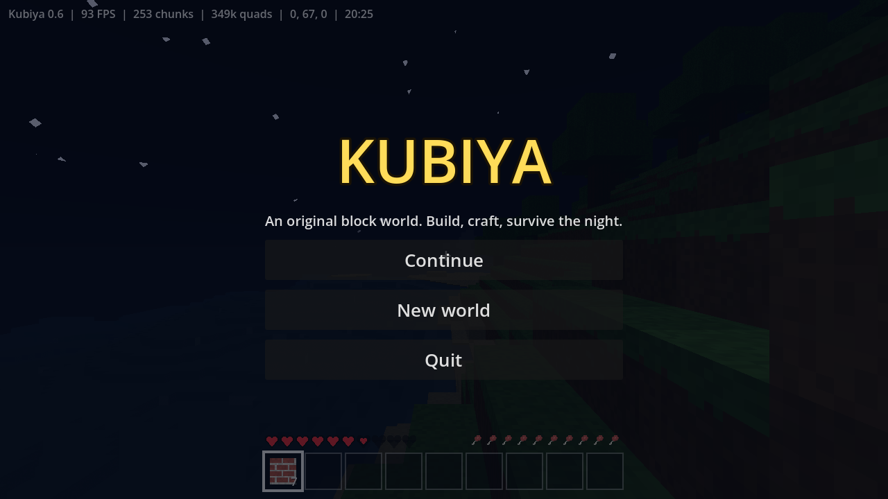
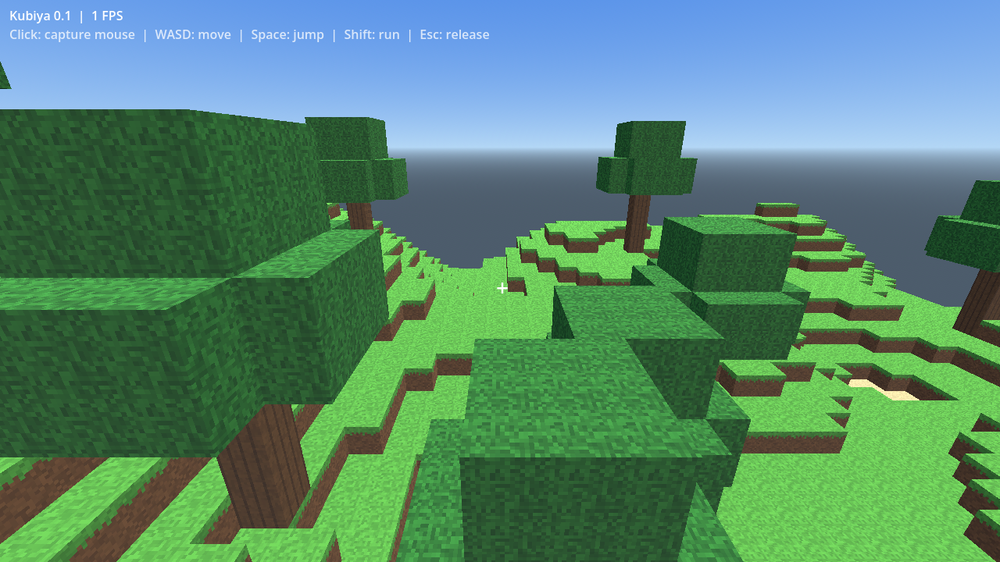
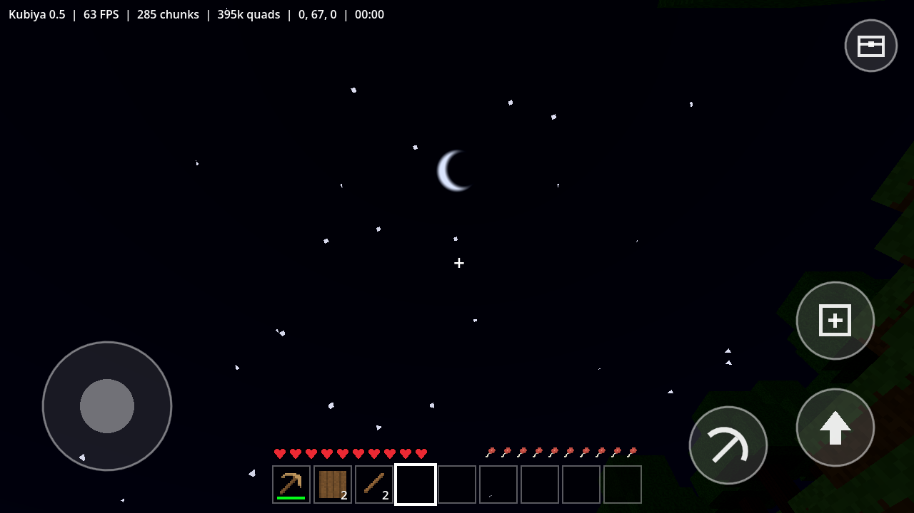
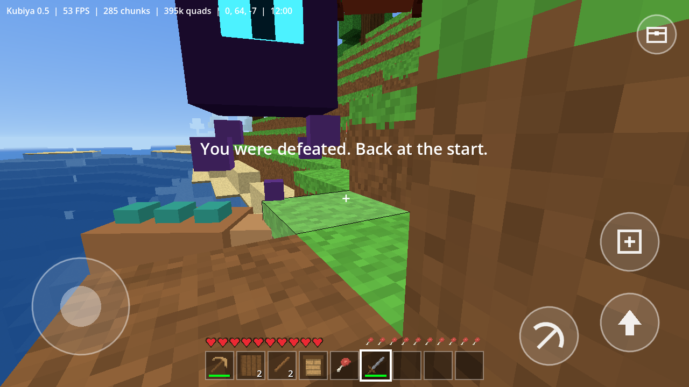
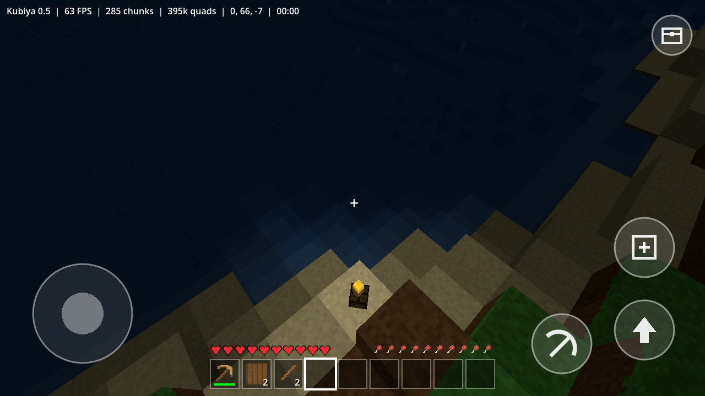
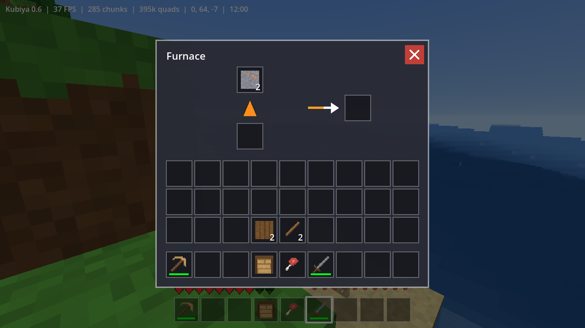

# Kubiya · קובייה

**English** | [עברית](#עברית)

Kubiya is an original, open-source 3D block sandbox game built with Godot 4 and GDScript.
It is made for computers: macOS, Windows, and the web browser.

Kubiya is not affiliated with Mojang or Microsoft and is not a copy of any existing game.
The name, textures, sounds and music are original. Textures are generated in code.

## Status

Early development. Stages 1 to 6 are done: an endless generated world with hills,
sea, caves, trees and ores; mining and building; item drops, inventory, crafting and
tools; day and night with sun, moon and stars; sky and torch light; health and
hunger; four original creatures; smelting and iron tools; saved worlds; title and
pause menus; sound and music generated in code.

| Stage | Content | State |
|-------|---------|-------|
| 1 | Repository, project skeleton, terrain, walking | Done |
| 2 | Endless world: 16x16x128 chunks, hills, water, caves, trees, ores, streaming | Done |
| 3 | First-person player, mining, building, hotbar, touch controls, sounds, music | Done |
| 4 | Item drops, inventory, 2x2 and 3x3 crafting, tools, torch, workbench | Done |
| 5 | Day and night, sky and torch light, health, hunger, creatures | Done |
| 6 | Save and load, furnace smelting, iron tools, title and pause menus | Done |
| 7 | macOS app in a `.dmg`, published on GitHub Releases | Done |
| 7b | Windows and web builds | Planned |
| 8 | Download site on GitHub Pages with the browser version | Planned |

## Controls

| Action | Key |
|--------|-----|
| Move | W A S D or arrow keys |
| Look | Mouse (click the window first) |
| Jump / swim up | Space |
| Run | Shift |
| Mine, hit a creature | Hold left mouse button |
| Place block, use workbench, eat | Right mouse button |
| Choose hotbar slot | 1 to 9, or mouse wheel |
| Inventory and 2x2 crafting | E |
| Music on / off | M |
| Pause menu | Esc |

The world is saved every minute, and when you leave through the menu or close the
window. One world is kept; "New world" on the title screen replaces it.

Touch screens also work: joystick on the left, buttons for jump, mine (hold) and place on the right,
drag anywhere else to look, tap a hotbar slot to choose it, bag button for the inventory.

## Survival

A day lasts 10 minutes. Caves and nights are dark; torches give light.
Health drops from long falls, creature attacks and starvation, and returns while
the hunger bar is nearly full. Eat meat or fruit with the place button.

| Creature | Behaviour |
|----------|-----------|
| Mokki | Small cream hopper with tall ears. Harmless. Drops meat |
| Dundle | Wide slow grazer with teal back plates. Harmless. Drops meat |
| Gloomer | Dark floating cube with one glowing eye. Night only. Chases and strikes |
| Skitter | Flat fast crawler with orange eyes. Night only. Chases and strikes |

Night creatures dissolve at sunrise.

## Crafting

Mined blocks fall as items; walk over them to pick them up. Open the inventory for
the 2x2 grid. Place a workbench and use it for the 3x3 grid. Tap a stack to pick it
up, tap a crafting cell to put down one item, tap the result to craft.

| Result | Recipe |
|--------|--------|
| 4 planks | 1 log |
| 4 sticks | 2 planks, one above the other |
| Workbench | 4 planks in a square |
| 4 torches | coal above a stick |
| Furnace | 8 stone in a ring |
| Pickaxe | 3 planks, stone or iron ingots in a row, 2 sticks below the middle |
| Axe | 3 planks, stone or iron ingots in an L, 2 sticks below |
| Shovel | 1 plank, stone or iron ingot, 2 sticks below |
| Sword | 2 planks, stone or iron ingots, 1 stick below |

Stone and coal need a pickaxe. Iron and gold need a stone pickaxe. Crystal needs an
iron pickaxe. The right tool mines faster. Tools wear out.

Use a placed furnace to smelt: iron ore into iron ingots, meat into cooked meat,
logs into coal. Fuel: coal, logs, planks, sticks.

## Install on a Mac

1. Download `Kubiya-<version>-mac.dmg` from the
   [latest release](https://github.com/shmuelr16/kubiya/releases/latest).
2. Open the file and drag Kubiya onto the Applications folder.
3. Open Kubiya from Applications.

The app runs on Intel and Apple Silicon Macs, macOS 11 or newer (10.13 on Intel).
It is not notarized by Apple, so the first launch is blocked. Open
System Settings > Privacy & Security, scroll down, and press "Open Anyway" next to
Kubiya. This is needed once.

Windows and browser versions are not built yet.

## Run from source

1. Install [Godot 4.7](https://godotengine.org/download) or newer.
2. Clone this repository.
3. Open `project.godot` in Godot and press F5.

## License

MIT. See [LICENSE](LICENSE).

---

## עברית

קובייה (Kubiya) הוא משחק בלוקים תלת־ממדי מקורי בקוד פתוח, בנוי ב־Godot 4 וב־GDScript.
המשחק מיועד למחשבים: מק, ווינדוס ודפדפן.

המשחק אינו קשור ל־Mojang או ל־Microsoft ואינו העתק של משחק קיים.
השם, הטקסטורות, הצלילים והמוזיקה מקוריים. הטקסטורות נוצרות בקוד.

### מצב

פיתוח מוקדם. שלבים 1 עד 6 הושלמו: עולם אינסופי עם גבעות, ים, מערות, עצים ועפרות; כרייה ובנייה; פריטים נופלים, מלאי, יצירת חפצים וכלים; יום ולילה עם שמש, ירח וכוכבים; אור שמיים ואור לפידים; בריאות ורעב; ארבעה יצורים מקוריים; התכה וכלי ברזל; שמירת עולם; מסך פתיחה ותפריט השהיה; צלילים ומוזיקה שנוצרים בקוד.

| שלב | תוכן | מצב |
|-----|------|-----|
| 1 | ריפו, שלד הפרויקט, עולם, הליכה | בוצע |
| 2 | עולם אינסופי: צ'אנקים 16x16x128, גבעות, מים, מערות, עצים, עפרות, טעינה דינמית | בוצע |
| 3 | שחקן בגוף ראשון, כרייה, בנייה, סרגל חפצים, שליטה במגע, צלילים, מוזיקה | בוצע |
| 4 | פריטים נופלים, מלאי, יצירה 2x2 ו־3x3, כלים, לפיד, שולחן עבודה | בוצע |
| 5 | יום ולילה, אור שמיים ולפידים, בריאות, רעב, יצורים | בוצע |
| 6 | שמירה וטעינה, התכה בתנור, כלי ברזל, מסך פתיחה ותפריט השהיה | בוצע |
| 7 | אפליקציית מק בתוך `.dmg`, מפורסמת ב־GitHub Releases | בוצע |
| 7b | גרסאות ווינדוס ודפדפן | מתוכנן |
| 8 | אתר הורדה ב־GitHub Pages עם גרסת הדפדפן | מתוכנן |

### מקשים

| פעולה | מקש |
|-------|-----|
| תנועה | W A S D או מקשי החצים |
| מבט | עכבר (קודם לוחצים על החלון) |
| קפיצה / שחייה למעלה | רווח |
| ריצה | Shift |
| כרייה, מכה ביצור | לחיצה ארוכה על כפתור שמאלי |
| הצבת בלוק, שימוש בשולחן עבודה, אכילה | כפתור ימני |
| בחירת משבצת בסרגל | 1 עד 9, או גלגלת |
| מלאי ויצירה 2x2 | E |
| מוזיקה | M |
| תפריט השהיה | Esc |

העולם נשמר כל דקה, וגם ביציאה דרך התפריט או בסגירת החלון. נשמר עולם אחד;
"New world" במסך הפתיחה מחליף אותו.

גם מסכי מגע נתמכים: ג'ויסטיק משמאל, כפתורי קפיצה, כרייה (לחיצה ארוכה) והצבה מימין,
גרירה בכל מקום אחר מזיזה את המבט, נגיעה במשבצת בסרגל בוחרת אותה, כפתור תיק פותח את המלאי.

### הישרדות

יום נמשך 10 דקות. מערות ולילות חשוכים; לפידים מאירים.
בריאות יורדת מנפילה גבוהה, מתקיפת יצורים ומרעב, וחוזרת כשמד הרעב כמעט מלא.
אוכלים בשר או פרי בכפתור ההצבה.

| יצור | התנהגות |
|------|---------|
| מוקי (Mokki) | קופצן קטן בצבע שמנת עם אוזניים גבוהות. לא מזיק. מפיל בשר |
| דנדל (Dundle) | רועה רחב ואיטי עם לוחות גב בצבע טורקיז. לא מזיק. מפיל בשר |
| גלומר (Gloomer) | קובייה כהה מרחפת עם עין זוהרת אחת. רק בלילה. רודף ותוקף |
| סקיטר (Skitter) | זוחל שטוח ומהיר עם עיניים כתומות. רק בלילה. רודף ותוקף |

יצורי הלילה מתפוגגים בזריחה.

### יצירת חפצים

בלוק שנכרה נופל כפריט; עוברים מעליו כדי לאסוף. המלאי כולל רשת 2x2. מציבים שולחן
עבודה ומשתמשים בו לרשת 3x3. נגיעה בערימה מרימה אותה, נגיעה במשבצת יצירה מניחה
פריט אחד, נגיעה בתוצאה יוצרת.

| תוצאה | מתכון |
|-------|-------|
| 4 קרשים | בול עץ אחד |
| 4 מקלות | 2 קרשים, אחד מעל השני |
| שולחן עבודה | 4 קרשים בריבוע |
| 4 לפידים | פחם מעל מקל |
| תנור | 8 אבנים בטבעת |
| מכוש | 3 קרשים, אבנים או מטילי ברזל בשורה, 2 מקלות מתחת לאמצע |
| גרזן | 3 קרשים, אבנים או מטילי ברזל בצורת L, 2 מקלות מתחת |
| את חפירה | קרש, אבן או מטיל ברזל, 2 מקלות מתחת |
| חרב | 2 קרשים, אבנים או מטילי ברזל, מקל מתחת |

אבן ופחם דורשים מכוש. ברזל וזהב דורשים מכוש אבן. קריסטל דורש מכוש ברזל.
הכלי המתאים כורה מהר יותר. כלים נשחקים.

תנור מוצב מתיך: עפרת ברזל למטילי ברזל, בשר לבשר מבושל, בולי עץ לפחם.
דלק: פחם, בולי עץ, קרשים, מקלות.

### התקנה במק

1. מורידים את `Kubiya-<version>-mac.dmg` מתוך
   [הגרסה האחרונה](https://github.com/shmuelr16/kubiya/releases/latest).
2. פותחים את הקובץ וגוררים את Kubiya לתיקיית Applications.
3. פותחים את Kubiya מתוך Applications.

האפליקציה רצה על מק אינטל ועל Apple Silicon, macOS 11 ומעלה (10.13 באינטל).
היא לא מאושרת (notarized) על ידי Apple, ולכן הפתיחה הראשונה נחסמת. פותחים
הגדרות המערכת > פרטיות ואבטחה, גוללים למטה ולוחצים "Open Anyway" ליד Kubiya.
צריך לעשות זאת פעם אחת.

גרסאות ווינדוס ודפדפן עדיין לא נבנו.

### הרצה מהקוד

1. מתקינים [Godot 4.7](https://godotengine.org/download) ומעלה.
2. משכפלים את הריפו.
3. פותחים את `project.godot` ב־Godot ולוחצים F5.

### רישיון

MIT. ראו [LICENSE](LICENSE).

